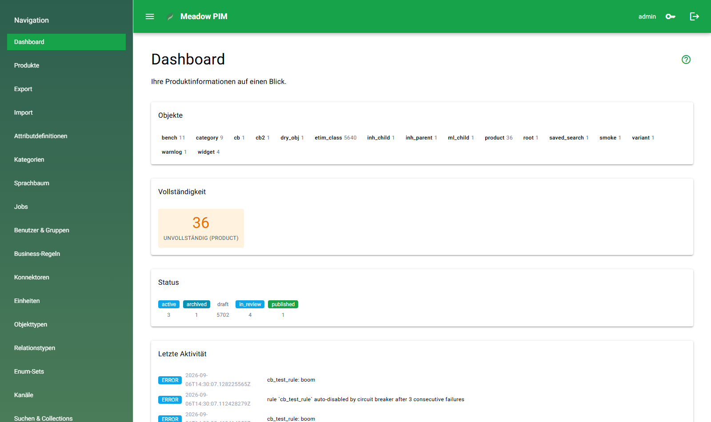

# Meadow PIM

Meadow PIM is a modern, high-performance **Product Information Management (PIM)**
system for small and medium-sized enterprises. It keeps product information as
flexible, typed objects — together with their attributes, relationships,
classifications and releases to output channels — on a fast Rust core with a
Python user interface.



**Status:** early development. The MVP scope is implemented (development phases
1–8 of the [architecture plan](plan/meadow-pim-architektur.md)), but the data
model, the REST API and the deployment setup still change. There is no released
version yet, and a fresh instance ships with a default administrator account that
has to be changed before any real use.

## What it does

- **Everything is an object.** Products, categories, assemblies and
  classification nodes share one data model and differ only by their **type**.
  Which fields a type may carry is decided by **attribute definitions** and
  **attribute groups**; required fields and per-type applicability are part of
  the definition.
- **Multilingual values.** A language tree with a configurable fallback order
  resolves language-dependent values. The interface language is independent of
  the languages used in the data.
- **Inheritance.** Along the composition edge (assembly to part) shared values
  are maintained once and inherited downwards. A local value overrides the
  inherited one, clearing it re-enables inheritance.
- **Relationships.** Typed relations with edge attributes, `composition` (1:n)
  versus `aggregation` (n:m), cycle-safe re-parenting, and business keys
  (unique keys) enforced per object type.
- **Classification and channels.** Multiple taxonomy trees, class features from
  imported classification standards (ETIM / BMEcat), and channel releases per
  object and channel.
- **Import and export.** The Meadow Exchange Format (MEF) for JSON, CSV and
  Excel through a column-mapping wizard, BMEcat export, plus inbound and
  outbound connectors and an event system for external systems.
- **Business rules.** Sandboxed Python scripts (RestrictedPython) for validation,
  computed attributes, normalization, publish guards and bulk operations, with a
  compile check, a dry run and a rule lab.
- **Search and collections.** Stored searches with filters, and materialized
  collections that refresh as a background job.
- **Bulk editing.** A wizard for mass changes (set or clear attributes, status,
  category, relations, re-parenting, delete) that runs as a background job and
  reports per object.
- **Jobs and scheduler.** Cron-scheduled and on-demand jobs (import, export,
  collection refresh, recompute) with progress, per-object reports and a run
  history.
- **Accounts and rights.** Role-based access (superadmin, admin, editor, viewer),
  group-based permission catalogs and attribute-based scopes.
- **Operations.** Audit log, curated system logs with retention, editable system
  settings, and a dashboard with completeness and status overviews.
- **Optional AI assistance** for the rule, search, connector, export, job and
  permission editors. It is opt-in and admin-only, and every suggestion lands in
  the field, never in the database.
- **User interface.** A grid-first NiceGUI application (configurable and pinnable
  columns, personal views, inline editing), object forms with collapsible
  attribute groups, and an in-app handbook in German and English.

## Architecture

Three services on shared infrastructure. The Rust core owns the database: the
frontend and the worker reach the data only through its REST API.

```
browser --> pim-frontend (:8081) --REST--> pim-core (:8080) --> SurrealDB
              (NiceGUI)                    (Rust/Axum)          documents + graph
                                                |   ^
                             NATS JetStream <---+   +--- pim-worker (Python)
                             (jobs + events)           rules, imports, exports,
                                                       connectors, AI assistance
```

- **`pim-core`** — the Rust service: REST API with an OpenAPI document, JWT
  authentication and authorization, the scheduler, and CRUD events published
  through a transactional outbox. It is the only writer to SurrealDB.
- **`pim-frontend`** — the NiceGUI application. It renders server-side and calls
  the core over REST.
- **`pim-worker`** — the Python service: rule evaluation on the synchronous write
  path, background jobs (import, export, collection refresh, bulk operations),
  webhook delivery, and the model calls of the AI assistance.
- **Infrastructure** — SurrealDB (documents and graph), NATS JetStream (job queue
  and event bus), S3-compatible object storage for export artifacts, and an
  optional Redis cache.

## Technology

| Layer | Choice |
| --- | --- |
| Core service | Rust (Edition 2024, MSRV 1.97), Axum, utoipa (OpenAPI), tokio |
| Database | SurrealDB (documents and graph, SurrealQL) |
| Messaging | NATS JetStream (job queue and event bus) |
| Frontend | Python 3.14, NiceGUI (server-rendered, AG Grid) |
| Worker | Python 3.14, asyncio, nats-py, httpx |
| Business rules | Pydantic models and a RestrictedPython sandbox |
| Object storage | S3-compatible (MinIO in development) |
| Authentication | JWT (HS256) with Argon2 password hashing |
| Packaging | Cargo workspace and uv (`pyproject.toml` / `uv.lock`) |
| Deployment | Docker and Docker Compose |

## Repository layout

| Path | Contents |
| --- | --- |
| `crates/pim-core/` | Rust core service (`pim-core`) |
| `meadow/` | Python package: `meadow.rules`, `meadow.worker`, `meadow.frontend` |
| `tests/` | Python test suite (pytest), including frontend page tests |
| `migrations/` | Numbered SurrealQL steps, applied by `scripts/run-migration.sh` |
| `docs/` | Non-planning documentation: user handbook (de/en), integration reference, developer notes |
| `plan/` | Architecture and technical planning (German), the authoritative specification |
| `scripts/` | Development helpers, demo-data generator, verification and deployment |
| `resources/` | Local vendor standard data (BMEcat / ETIM), not versioned |
| `docker/` | Production Dockerfiles |

## Getting started (development)

### Prerequisites

- **uv** — the Python package manager; it provides the project's Python 3.14
- **Rust** — the stable toolchain via rustup, Edition 2024, MSRV 1.97
- **Docker** with Compose — the local infrastructure
- **Windows only:** the MSVC Build Tools (Visual Studio workload "Desktop
  development with C++") as the linker for `rustc`

On Windows, [`scripts/setup.ps1`](scripts/setup.ps1) is idempotent and does the
bootstrap: it installs uv if it is missing, adds the `rustfmt` and `clippy`
components, creates `.venv/` and syncs the dependencies. On Linux and macOS,
install uv and the Rust toolchain, then run `uv sync`.

### 1. Start the infrastructure

```powershell
powershell -File scripts/run-dev.ps1             # Windows
```

```bash
docker compose -f docker-compose.dev.yml up -d   # Linux / macOS
```

This starts SurrealDB (:8000), NATS (:4222, monitoring on :8222), MinIO
(:9000 and console :9001), Redis (:6379) and MailHog (:1025 SMTP, web UI on
:8025).

### 2. Set the secrets

The repository is public, so the signing secrets have **no default** — the core
and the frontend refuse to start without them, and both need at least 32
characters. The core and the worker must also share the same machine key;
without it every worker write path is rejected with `401`.

```powershell
$env:JWT_SECRET = "development-machine-jwt-key-change-per-machine"        # core
$env:UI_STORAGE_SECRET = "development-machine-ui-key-change-per-machine"  # frontend
$env:LOG_INGEST_API_KEY = "dev-machine-key"                              # core AND worker
```

```bash
export JWT_SECRET=development-machine-jwt-key-change-per-machine
export UI_STORAGE_SECRET=development-machine-ui-key-change-per-machine
export LOG_INGEST_API_KEY=dev-machine-key
```

These values are for local development only; each machine uses its own.
The production template with every supported variable is
[`.env.vps.example`](.env.vps.example).

### 3. Run the services

The three services are separate processes. Run each in its own terminal, with the
environment from step 2 set in each.

```bash
cargo run -p pim-core             # REST API on http://127.0.0.1:8080
uv run python -m meadow.worker    # rules, jobs, connectors, AI assistance
uv run python -m meadow.frontend  # UI on http://127.0.0.1:8081
```

Open <http://127.0.0.1:8081> and sign in as `admin` / `admin`. The core seeds
that account on the first start against an empty database, so change the password
immediately.

### 4. Load demo data (optional)

```bash
uv run python scripts/demo_data.py --profile tiny --import
```

This fills the instance with a deterministic, synthetic automotive catalogue:
vehicle data, spare parts with variants, taxonomy, channel releases, collections,
searches and rules. The generator is repeatable (the same seed produces the same
data, a second run updates instead of duplicating), `--cleanup` removes the
inventory again, and `--profile demo` or `perf` scales it up. See the handbook
chapter [Demo data](docs/user/en/06-demo-daten.md).

## Verification

```powershell
powershell -File scripts/check.ps1        # Windows
```

```bash
bash scripts/check.sh                     # Linux / macOS / CI
```

Both run the same gates as CI: `cargo fmt --check`,
`cargo clippy --all-targets -- -D warnings`, `cargo test`, `uv sync`,
`ruff check`, `ruff format --check`, `mypy` and `pytest`. Pass `rust` or `python`
to select a subset. On Windows the core must not be running while the gates
relink its binary.

## Documentation

- [User handbook](docs/user/) — task-oriented chapters in German
  (`docs/user/de/`) and English (`docs/user/en/`), also rendered inside the
  application under `/help`.
- [MEF and event system](docs/integration/mef-and-events.md) — the import/export
  JSON format and the event contract for external systems.
- [Architecture and technical plan](plan/meadow-pim-architektur.md) — the
  authoritative specification, written in German.
- [Developer notes](docs/developer/) — the rule contract and the sandbox policy
  of the business-rules engine.

## Deployment

Production runs on Docker Compose (`docker-compose.vps.yml`). Images are built on
the development machine and pushed to a registry; the server pulls them and
applies the migrations before it starts the application. All configuration lives
in a `.env.vps` file (template: [`.env.vps.example`](.env.vps.example)); the
operational details are in
[plan/detail/betrieb-deployment.md](plan/detail/betrieb-deployment.md) (German).

## Contributing

Source code, comments and documentation are written in English, planning
documents in German. Run the gates above before opening a pull request, and keep
the documentation consistent with the change: the plan for architecture and
contracts, `docs/` for user-facing and integration text. The `AGENTS.md` files
describe how each area of the repository is maintained.

## License

MIT — see [LICENSE](LICENSE).

The self-hosted SurrealDB server is licensed under BSL 1.1 (change date
2030-01-01, then Apache 2.0). Running it as part of Meadow PIM is permitted;
offering SurrealDB itself as a database service is not.