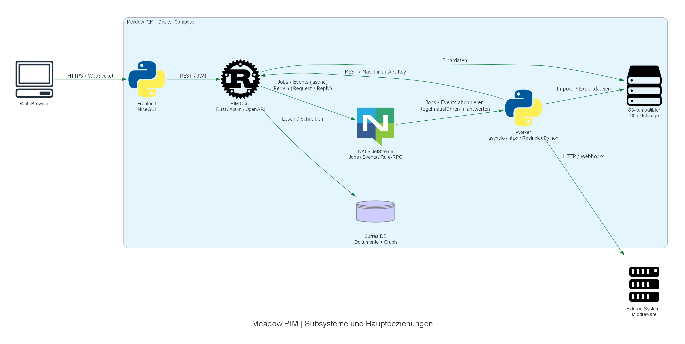

# Planbasierte Architekturdiagramme

Die Diagramme sind abgeleitete Ansichten des [Hauptplans](../../plan/meadow-pim-architektur.md)
und seiner [Detaildokumente](../../plan/detail/). Die Pläne bleiben die Spezifikation;
die Grafiken ersetzen weder ihre Verträge noch ihre Statusangaben.

## Gesamtübersicht

Nur Subsysteme und ihre Hauptbeziehungen aus den Abschnitten 2–3 des Hauptplans:
Browser, NiceGUI, Rust-Kern, Python-Worker, SurrealDB, NATS JetStream,
S3-kompatibler Objektstorage und externe Middleware. Tabellen, einzelne Endpunkte,
fachliche Modelle und Detailabläufe gehören ausschließlich in die Detailansichten.
Optionale spätere Infrastruktur wie Redis, k3s oder ein Monitoring-Stack ist
bewusst nicht Teil dieser MVP-Systemübersicht.



[Python-Quelle](overview.py) · [SVG zum Zoomen](rendered/overview.svg) ·
[PNG](rendered/overview.png)

## Erzeugen

Voraussetzungen: Projekt-venv mit den Dev-Abhängigkeiten (`uv sync --dev`) und
**Graphviz** als separates Systemprogramm. Das Python-Paket `graphviz` allein
enthält kein `dot`-Programm. `dot -V` muss im ausführenden Terminal funktionieren.

Vom Repository-Wurzelverzeichnis:

```powershell
uv run python docs\diagrams\render.py
uv run python docs\diagrams\render.py --list
uv run python docs\diagrams\render.py --only overview business_rules
uv run python docs\diagrams\overview.py
```

Unter Linux dieselben Befehle mit `/` statt `\` verwenden.
Ist Graphviz unter Windows installiert, aber noch nicht im PATH, lässt es sich
für das aktuelle Terminal ergänzen, zum Beispiel:

```powershell
$env:PATH = 'C:\Program Files (x86)\Graphviz\bin;' + $env:PATH
dot -V
```

Alle Skripte schreiben unabhängig vom Arbeitsverzeichnis nach `rendered/`.
Es werden **PNG und SVG** erzeugt, ohne Bildbetrachter zu öffnen.
Die SVG-Dateien enthalten eingebettete Icons und benötigen weder die lokale
venv noch absolute Bildpfade. Anwendung, Datenbank, Zugangsdaten und Netzwerk
werden zum Rendern nicht benötigt. Grafiken nur durch Neuausführen ändern.
Referenzlauf: `diagrams` 0.25.1 und Graphviz 16.1.0.

## Einheitliche Bildsprache

Die Icon-Auswahl und das Layout kommen aus [_shared.py](_shared.py):

| Darstellung | Bedeutung |
| --- | --- |
| Rust-Icon | Rust-Kern oder ein logisch betrachteter Baustein darin |
| Python-Icon | NiceGUI-Frontend, Worker oder ein logisch betrachteter Python-Baustein |
| NATS-Icon | NATS JetStream oder ein darin betrachteter Stream |
| Traefik-Icon | Reverse Proxy im Deployment |
| Datenbank-Zylinder | SurrealDB oder eine ausdrücklich benannte logische Entität |
| Storage-Icon | S3-kompatibler Objektspeicher, ohne Bindung an einen Cloud-Anbieter |
| Browser / Benutzer / Server | Client, Akteur beziehungsweise externes System |
| Dokument / Prozess / Entscheidung | Artefakt, Verarbeitungsschritt beziehungsweise Bedingung |
| Grüne durchgezogene Kante | Aufruf, Datenfluss, Abhängigkeit oder fachliche Beziehung gemäß Beschriftung |
| Blaue gestrichelte Kante | Asynchrone Zustellung |
| Braune gestrichelte Kante | Optionale Nutzung oder gesonderte Abnahme |

Eine Kante zeigt die **beschriftete** Beziehung, nicht automatisch einen
Netzwerkaufruf. Cluster grenzen logische Modelle, Abläufe oder Dienste ab;
mehrere Zylinder bedeuten nicht mehrere Datenbankinstanzen.
Der Rust-Kern bleibt die einzige Instanz mit direktem Datenbank-Schreibzugriff.
Fachliche Kompositionskanten zeigen immer **Kind → Elternteil**.

## Detailansichten und bewusste Auswahl

Alle **27 Detaildokumente** wurden auf eine sinnvolle grafische Darstellung
geprüft. Jedes enthält einen eigenständigen Zusammenhang, der als Modell,
Datenfluss oder Ablauf verständlicher wird. Deshalb wird keines ganz
ausgelassen. Pro Dokument wird aber nur **eine fokussierte Ansicht** gezeigt:
keine vollständigen Endpunktlisten, Tabellenfelder, Forschungsnotizen,
Messprotokolle oder historischen Umbauschritte.

### Fachliches Modell

| Quelldokument | Fokus / Auswahl | Python | Grafik |
| --- | --- | --- | --- |
| [Datenmodell](../../plan/detail/datenmodell.md) | Generische Objekte, Metadaten, Referenzen und Freigaben; kein vollständiges ERD | [Quelle](datenmodell.py) | [SVG](rendered/datenmodell.svg) · [PNG](rendered/datenmodell.png) |
| [Relationen](../../plan/detail/relationen.md) | Komposition gegenüber Aggregation, Kantenrichtung und Re-Parenting | [Quelle](relationen.py) | [SVG](rendered/relationen.svg) · [PNG](rendered/relationen.png) |
| [Wertvererbung](../../plan/detail/datenwertvererbung.md) | Eigener Wert, fehlender Schlüssel und expliziter Unterbrecher; keine Cache-Interna | [Quelle](datenwertvererbung.py) | [SVG](rendered/datenwertvererbung.svg) · [PNG](rendered/datenwertvererbung.png) |
| [Sprachbaum](../../plan/detail/sprachbaum-mehrsprachigkeit.md) | Fachlicher Sprach-Fallback, getrennt von UI-Übersetzungen | [Quelle](sprachbaum_mehrsprachigkeit.py) | [SVG](rendered/sprachbaum_mehrsprachigkeit.svg) · [PNG](rendered/sprachbaum_mehrsprachigkeit.png) |
| [Einheiten](../../plan/detail/einheiten.md) | Zentrale Umrechnung und kanonische Zahl gegenüber Ein-/Ausgabedarstellung | [Quelle](einheiten.py) | [SVG](rendered/einheiten.svg) · [PNG](rendered/einheiten.png) |
| [Kategorisierung](../../plan/detail/kategorisierung.md) | Gemeinsame Taxonomie, unabhängige Dimensionen und Klassen-Merkmale | [Quelle](kategorisierung.py) | [SVG](rendered/kategorisierung.svg) · [PNG](rendered/kategorisierung.png) |
| [Konsolidierung](../../plan/detail/vererbung-konsolidierung.md) | Vorschaujob, Elternwert schreiben, erst danach Kindkopien entfernen | [Quelle](vererbung_konsolidierung.py) | [SVG](rendered/vererbung_konsolidierung.svg) · [PNG](rendered/vererbung_konsolidierung.png) |
| [Workflow und Freigaben](../../plan/detail/workflow-freigaben.md) | Guards sowie unabhängiger globaler und kanalspezifischer Status; keine erfundene feste Zustandsmaschine | [Quelle](workflow_freigaben.py) | [SVG](rendered/workflow_freigaben.svg) · [PNG](rendered/workflow_freigaben.png) |
| [Versionierung und Audit](../../plan/detail/versionierung-audit.md) | Versionsfelder, dauerhafte Historie und begrenzte Event-Retention; kein Snapshot-/Restore-System | [Quelle](versionierung_audit.py) | [SVG](rendered/versionierung_audit.svg) · [PNG](rendered/versionierung_audit.png) |

### Kern, Integration und Hintergrundarbeit

| Quelldokument | Fokus / Auswahl | Python | Grafik |
| --- | --- | --- | --- |
| [API-Design](../../plan/detail/api-design.md) | Autorisierung, Datenpfad und asynchrone Aufträge statt einer Endpunkt-Landkarte | [Quelle](api_design.py) | [SVG](rendered/api_design.svg) · [PNG](rendered/api_design.png) |
| [Benutzer, Gruppen und Rechte](../../plan/detail/benutzer-gruppen-rechte.md) | Login-Ableitung, JWT, RBAC und query-seitiger ABAC-Scope | [Quelle](benutzer_gruppen_rechte.py) | [SVG](rendered/benutzer_gruppen_rechte.svg) · [PNG](rendered/benutzer_gruppen_rechte.png) |
| [Business Rules](../../plan/detail/business-rules.md) | Schreibpfad, gemeinsame Sandbox, Import- und Job-Kontext | [Quelle](business_rules.py) | [SVG](rendered/business_rules.svg) · [PNG](rendered/business_rules.png) |
| [Jobs und Scheduler](../../plan/detail/jobs-scheduler.md) | Definition → Lauf → Zustellung → Ergebnis / Retry / DLQ | [Quelle](jobs_scheduler.py) | [SVG](rendered/jobs_scheduler.svg) · [PNG](rendered/jobs_scheduler.png) |
| [Integration und Events](../../plan/detail/integration-eventsystem.md) | MEF-Inbound und transaktionaler Outbox-/Webhook-Outbound | [Quelle](integration_eventsystem.py) | [SVG](rendered/integration_eventsystem.svg) · [PNG](rendered/integration_eventsystem.png) |
| [Konnektoren](../../plan/detail/konnektor-konfiguration.md) | Schemaformular, getrennte Secrets, Tests und Zustandsmeldung; keine Plugin-Laufzeit | [Quelle](konnektor_konfiguration.py) | [SVG](rendered/konnektor_konfiguration.svg) · [PNG](rendered/konnektor_konfiguration.png) |
| [MCF-Export und -Import](../../plan/detail/konfiguration-export-import.md) | Stabile Schlüssel und Restore-Reihenfolge Modell → Daten → Klassen-Merkmale | [Quelle](konfiguration_export_import.py) | [SVG](rendered/konfiguration_export_import.svg) · [PNG](rendered/konfiguration_export_import.png) |
| [Suchen und Collections](../../plan/detail/gespeicherte-suchen-collections.md) | Dynamische Query gegenüber atomar erneuerter materialisierter Mitgliedschaft | [Quelle](gespeicherte_suchen_collections.py) | [SVG](rendered/gespeicherte_suchen_collections.svg) · [PNG](rendered/gespeicherte_suchen_collections.png) |
| [BMEcat](../../plan/detail/bmecat-export.md) | Modell und Exportprofil → XML; XSD-/DTD-Prüfung separat, kein implementierter BMEcat-Import | [Quelle](bmecat_export.py) | [SVG](rendered/bmecat_export.svg) · [PNG](rendered/bmecat_export.png) |

### Oberfläche und Assistenz

| Quelldokument | Fokus / Auswahl | Python | Grafik |
| --- | --- | --- | --- |
| [Frontend](../../plan/detail/frontend.md) | Ein Dienst, Sitzung und Präferenzen, REST und getrennte Sprachwelten | [Quelle](frontend.py) | [SVG](rendered/frontend.svg) · [PNG](rendered/frontend.png) |
| [Arbeitsflächen](../../plan/detail/frontend-arbeitsflaechen.md) | Grid, Einzelobjekt und Bulk-Wizard mit gemeinsamer Auswahl | [Quelle](frontend_arbeitsflaechen.py) | [SVG](rendered/frontend_arbeitsflaechen.svg) · [PNG](rendered/frontend_arbeitsflaechen.png) |
| [Suchformular](../../plan/detail/suche-formular.md) | Ein Server-Katalog und eine validierte Query-DSL für Suche und Grid | [Quelle](suche_formular.py) | [SVG](rendered/suche_formular.svg) · [PNG](rendered/suche_formular.png) |
| [Import-/Export-Oberfläche](../../plan/detail/datenexport-import-ui.md) | Assistent, Job, Bericht und optionale S3-/E-Mail-Zustellung | [Quelle](datenexport_import_ui.py) | [SVG](rendered/datenexport_import_ui.svg) · [PNG](rendered/datenexport_import_ui.png) |
| [KI-Assistenz](../../plan/detail/ki-assistenz.md) | Worker-Aufruf, Metadatenkontext, Prüfung und menschliches Speichern; kein Agenten-Framework, kein Erklär-Streaming-Detailablauf | [Quelle](ki_assistenz.py) | [SVG](rendered/ki_assistenz.svg) · [PNG](rendered/ki_assistenz.png) |
| [Dokumentation und Hilfe](../../plan/detail/dokumentation-und-hilfe.md) | Markdown → gecachter Katalog → In-App-Hilfe; erzeugte Screenshots | [Quelle](dokumentation_und_hilfe.py) | [SVG](rendered/dokumentation_und_hilfe.svg) · [PNG](rendered/dokumentation_und_hilfe.png) |

### Betrieb und Entwicklung

| Quelldokument | Fokus / Auswahl | Python | Grafik |
| --- | --- | --- | --- |
| [Deployment](../../plan/detail/betrieb-deployment.md) | Lokaler Build / Registry / VPS, Netzgrenzen und Backups; kein vollständiges Runbook | [Quelle](betrieb_deployment.py) | [SVG](rendered/betrieb_deployment.svg) · [PNG](rendered/betrieb_deployment.png) |
| [Demodaten](../../plan/detail/demodaten-generator.md) | Deterministische Erzeugung, geteilte Objekte vor Chunks, geordneter Import und Abnahme | [Quelle](demodaten_generator.py) | [SVG](rendered/demodaten_generator.svg) · [PNG](rendered/demodaten_generator.png) |
| [Codequalität](../../plan/detail/ai-code-quality.md) | Manueller Analyse- und Reparaturworkflow neben verbindlichen Gates; keine Laufzeitarchitektur | [Quelle](ai_code_quality.py) | [SVG](rendered/ai_code_quality.svg) · [PNG](rendered/ai_code_quality.png) |

Historische `Stand: Entwurf`-Köpfe einzelner Pläne sind kein Beleg, dass ein
inzwischen umgesetzter Mechanismus fehlt. Die Ansichten folgen den aktuellen
inhaltlichen Verträgen, den neueren Ergänzungen und den übergeordneten
Projektverträgen; sie behaupten keine pauschale Produktionsreife.

## Prüfen

```powershell
uv run ruff check docs\diagrams tests\test_diagrams.py
uv run ruff format --check docs\diagrams tests\test_diagrams.py
uv run mypy docs\diagrams tests\test_diagrams.py
uv run pytest tests\test_diagrams.py
```

Die Tests prüfen die vollständige Plan-Zuordnung, die dokumentierte
Quelldateiliste sowie PNG-/SVG-Paare einschließlich eingebetteter SVG-Icons.
Sie benötigen kein Graphviz; der tatsächliche Renderlauf oben prüft zusätzlich
alle `diagrams`-Aufrufe und das lokale Graphviz.
